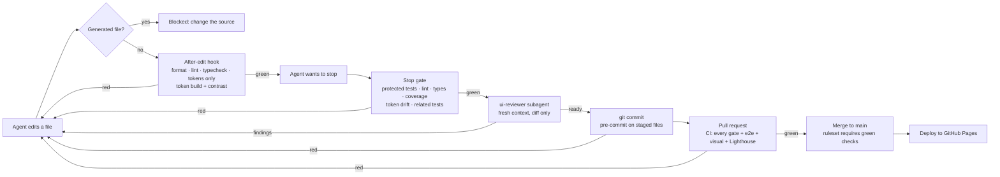

# The harness: checks decide when work is done

AI agents write most of the code in this repo. What makes the result trustworthy is not the agents but the harness around them: checks that run on every edit, a gate the agent can't talk its way past, a reviewer that didn't write the code, and CI that blocks the merge and the deploy. Decisions: [0014](decisions/0014-checks-decide-done.md)–[0018](decisions/0018-visual-regression-per-component.md).

## The loop

## Layers

| Layer | Where | Runs | Catches | Time |
|---|---|---|---|---|
| Guard: generated files | `PreToolUse` hook | before every edit | hand edits to `tokens.css`, `tokens.ts`, `tokens/figma/*` | instant |
| Guard: hook bypass | `PreToolUse` hook on Bash | before every shell command | no-verify flag, `git commit -n`, skip variables, `core.hooksPath` | instant |
| After edit | `PostToolUse` hook | after every edit | format, lint (incl. jsx-a11y), types, hardcoded visual values, token validation + contrast | 1–5 s |
| Stop gate | `Stop` hook | when the agent wants to finish | removed or switched-off tests, lint, types, story and test coverage, token drift, tests related to everything changed since `main` | 10–90 s |
| Independent review | `ui-reviewer` subagent | before a PR | design-system rules, accessibility, weakened tests, bugs in the gates themselves | 2–4 min |
| Pre-commit | `simple-git-hooks` + `lint-staged` | every commit, by anyone | format, lint, types, tokens only, token drift + contrast | seconds |
| CI | GitHub Actions | every PR and push | everything above, plus unit / component / story tests in light and dark, e2e, axe on every screen, visual regression (screens + components), bundle budget, Lighthouse | ~15 min |
| Branch protection | ruleset on `main` | merge | a PR whose checks aren't green | — |
| Manual | [accessibility.md](design-system/accessibility.md#manual-checks-per-release) | per release | keyboard-only and VoiceOver pass on one key flow | 20 min |

Every layer is cheaper than the next, so most problems are fixed seconds after they are made. CI is the backstop, not the first line.

## Why not just an orchestrator and a few agents?

| | Orchestrator + agents | Harness |
|---|---|---|
| Who decides "done" | the agent that did the work, or the orchestrator reading its summary | checks that ran on the actual files |
| When problems show up | at review or in CI, after a push | on the edit that caused them |
| A wrong claim ("tests pass") | trusted | can't end the turn: the Stop gate reruns the checks |
| Weakening a test to pass | invisible in a summary | blocked: deleted or switched-off tests need a person |
| Review | another agent that shares the context and the assumptions | a reviewer with fresh context and only the diff |
| Rules | in prompts, followed when remembered | in hooks, CI and branch protection; prompts only explain them |
| Adding more agents | more output to check | each agent hits the same gates |

The agents are interchangeable. The harness is what the team owns.

## Evidence from building it

The harness was built with the same agents it now constrains (PRs #2–#8), and it caught them:

- **The reviewer found 47 issues in six PRs** of harness code that had passed the author's own tests. Among them: the Stop gate passed once work was committed, token validation skipped references inside shadows, the tokens-only scan stopped at `//` inside a URL, adding test reporters silently dropped GitHub annotations.
- **The after-edit hook** stopped a lint error in a new script one edit after it was written.
- **The Stop gate** refused to let a turn end over conditional `test.skip` calls; the agent asked instead of loosening the rule, and the rule was narrowed with tests on Igor's call.
- **The Stop gate** caught an intermittent test failure the agent had called fixed, which led to an honest record of what is and isn't known ([ai-log](ai-log.md)).
- **The Bash guard** blocked the agent's own docs edit that only mentioned the no-verify flag: a false positive, fixed with 16 test cases.

## Demos

Three branches show the gates live. Each has one commit that breaks something; open a PR from it, watch CI, then push the fix.

1. **Accessibility gate** (`demo/a11y-gate`): the header's Display settings icon button loses its accessible name. The story and component tests fail on axe `button-name` in light and dark; CI shows **Blocked**. Fix: restore the label (`git revert HEAD`) and push; the checks go green.
2. **Token change → visual diffs** (`demo/token-diff`): one semantic token changes (`radius.control`). The pre-commit hook rebuilds and checks contrast; CI's visual regression fails on every component that uses a control radius, and the `playwright-report` artifact holds expected / actual / diff images for each. To accept a deliberate change, run the Update screenshots workflow on the branch and commit the new baselines.
3. **CI blocks the deploy** (`demo/ci-blocks-deploy`): a formatting change rounds money to whole euros. Unit and component tests fail; the PR can't merge (ruleset) and nothing deploys. Fix with `git revert HEAD`; the merge button turns green.
